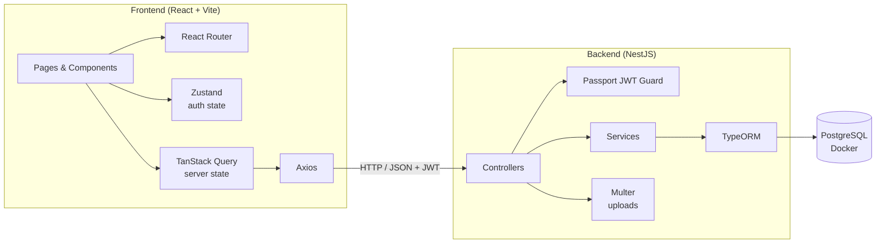
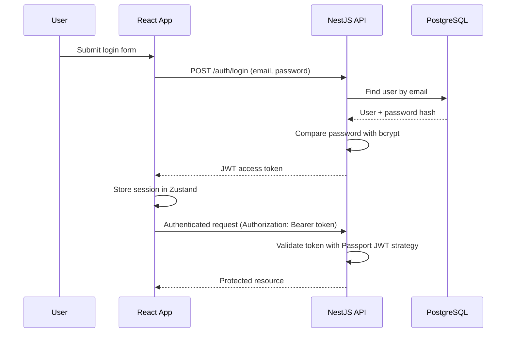

<div align="center">

# 🛍️ TesloShop

**A full-stack e-commerce platform built with React 19 and NestJS.**

JWT authentication · Image uploads · Server-state caching · PostgreSQL · Dockerized database


</div>

---

<!--
SCREENSHOTS (uncomment and add your images when ready):

## 📸 Screenshots

| Home / Catalog | Login | Product detail |
|---|---|---|
|  |  |  |
-->

## 📋 Table of Contents

- [Overview](#-overview)
- [Features](#-features)
- [Tech Stack](#-tech-stack)
- [Architecture](#-architecture)
- [Authentication Flow](#-authentication-flow)
- [API Overview](#-api-overview)
- [Project Structure](#-project-structure)
- [Getting Started](#-getting-started)
- [Environment Variables](#-environment-variables)
- [Available Scripts](#-available-scripts)
- [Troubleshooting](#-troubleshooting)
- [Contributing](#-contributing)
- [License](#-license)
- [Author](#-author)

---

## 📌 Overview

**TesloShop** is a full-stack e-commerce application split into a React single-page frontend and a NestJS REST API. The frontend focuses on a fast, accessible user experience with server-state caching and validated forms, while the backend handles authentication, data persistence and file uploads on top of PostgreSQL.

The project is designed as a realistic, production-style architecture: typed end to end with TypeScript, secured with JWT, and easy to run locally thanks to Docker Compose.

---

## ✨ Features

### 🔐 Authentication & Security
- User registration and login with **JWT** and **Passport**.
- Passwords hashed with **bcrypt**.
- Session state managed globally on the client with **Zustand**.

### 🛒 Shop Experience
- Product data fetched, cached and revalidated with **TanStack Query**.
- Client-side routing with **React Router**.
- Validated, performant forms with **React Hook Form**.
- Responsive, accessible UI built with **Tailwind CSS 4**, **Radix UI** and shadcn/ui-style components.

### 🖼️ Media
- Product image uploads handled by **Multer** on the backend.

### 🏗 Engineering
- Fully typed with **TypeScript** on the frontend.
- Relational data model managed with **TypeORM** and **PostgreSQL**.
- PostgreSQL provisioned locally with **Docker Compose**.

---

## 💻 Tech Stack

### Frontend

| Technology | Purpose |
|---|---|
| [React 19](https://react.dev/) | UI library |
| [TypeScript](https://www.typescriptlang.org/) | Static typing |
| [Vite](https://vitejs.dev/) | Dev server and build tool |
| [Tailwind CSS 4](https://tailwindcss.com/) | Utility-first styling |
| [Radix UI](https://www.radix-ui.com/) + [shadcn/ui](https://ui.shadcn.com/)-style components | Accessible UI primitives |
| [Zustand](https://zustand-demo.pmnd.rs/) | Authentication state |
| [TanStack Query](https://tanstack.com/query) | Server state and API queries |
| [React Router](https://reactrouter.com/) | Routing |
| [React Hook Form](https://react-hook-form.com/) | Form handling and validation |
| [Axios](https://axios-http.com/) | HTTP client |

### Backend

| Technology | Purpose |
|---|---|
| [NestJS](https://nestjs.com/) | Server framework |
| [TypeORM](https://typeorm.io/) | ORM |
| [PostgreSQL](https://www.postgresql.org/) | Relational database |
| [Passport](https://www.passportjs.org/) + JWT | Authentication strategies |
| [bcrypt](https://github.com/kelektiv/node.bcrypt.js) | Password hashing |
| [Multer](https://github.com/expressjs/multer) | Multipart file uploads |

### Infrastructure

| Technology | Purpose |
|---|---|
| [Docker Compose](https://docs.docker.com/compose/) | Local PostgreSQL container |

---

## 🏗 Architecture



---

## 🔑 Authentication Flow



---

## 🔌 API Overview

> Endpoint names below are indicative. Adjust them to match your controllers.

| Method | Endpoint | Description | Auth |
|---|---|---|---|
| `POST` | `/auth/register` | Create a new user | ❌ |
| `POST` | `/auth/login` | Authenticate and receive a JWT | ❌ |
| `GET` | `/products` | List products | ❌ |
| `GET` | `/products/:id` | Get a single product | ❌ |
| `POST` | `/products` | Create a product | ✅ |
| `PATCH` | `/products/:id` | Update a product | ✅ |
| `DELETE` | `/products/:id` | Delete a product | ✅ |
| `POST` | `/files/product` | Upload a product image | ✅ |

---

## 📁 Project Structure

```text
TesloShop/
├── backend/                  # NestJS REST API
│   ├── src/                  # Modules, controllers, services, entities
│   ├── .env.example          # Environment variable template
│   └── package.json
├── frontend/                 # React + Vite application
│   ├── src/                  # Pages, components, hooks, stores, API layer
│   ├── index.html
│   └── package.json
├── docker-compose.yml        # PostgreSQL container
└── README.md
```

---

## 🚀 Getting Started

### Prerequisites

- [Node.js](https://nodejs.org/) (LTS recommended)
- [Docker Desktop](https://www.docker.com/products/docker-desktop/) installed and running
- [Git](https://git-scm.com/)

### 1. Clone the repository

```bash
git clone https://github.com/dereksxt/TesloShop.git
cd TesloShop
```

### 2. Start the database

```bash
docker compose up -d
```

### 3. Run the backend

```bash
cd backend
npm install
cp .env.example .env   # fill in your own values
npm run start:dev
```

### 4. Run the frontend

In a new terminal:

```bash
cd frontend
npm install
npm run dev
```

### 5. Open the app

| Service | URL |
|---|---|
| Frontend | http://localhost:5173 |
| Backend API | http://localhost:3000 |

---

## 🔧 Environment Variables

Create a `.env` file in the backend folder:

```env
# Database
DB_HOST=localhost
DB_PORT=5432
DB_NAME=teslodb
DB_USERNAME=postgres
DB_PASSWORD=yourpassword

# Security
JWT_SECRET=your_super_secret_jwt_key

# Server
PORT=3000
```

> ⚠️ These are placeholder values. Use your own credentials, never commit your real `.env`, and make sure it is listed in `.gitignore`.

---

## 📜 Available Scripts

### Frontend

| Command | Description |
|---|---|
| `npm run dev` | Starts the Vite development server |
| `npm run build` | Type-checks and builds for production |
| `npm run preview` | Previews the production build |
| `npm run lint` | Runs ESLint |

### Backend

| Command | Description |
|---|---|
| `npm run start:dev` | Starts the API in watch mode |
| `npm run build` | Compiles the project |
| `npm run start:prod` | Runs the compiled build |

---

## 🩺 Troubleshooting

| Problem | Solution |
|---|---|
| Port `5432` already in use | Stop any local PostgreSQL service or change the port mapping in `docker-compose.yml`. |
| Backend cannot connect to the database | Check that the container is running (`docker compose ps`) and that the `DB_*` values in `.env` match the compose file. |
| Frontend cannot reach the API | Make sure the backend is running on port `3000` and that the API base URL in the frontend matches. |
| `401 Unauthorized` on protected routes | Log in again; the JWT may have expired or `JWT_SECRET` may have changed. |

---

## 🤝 Contributing

Contributions, issues and feature requests are welcome! Feel free to check the [issues page](https://github.com/dereksxt/TesloShop/issues).

1. Fork the project
2. Create your feature branch (`git checkout -b feature/AmazingFeature`)
3. Commit your changes (`git commit -m 'feat: add some AmazingFeature'`)
4. Push to the branch (`git push origin feature/AmazingFeature`)
5. Open a Pull Request

---

## 📄 License

This project is licensed under the MIT License — see the [LICENSE](LICENSE) file for details.

---

<div align="center">

**Built by [Derek Serpa](https://github.com/dereksxt)** 💻

</div>
